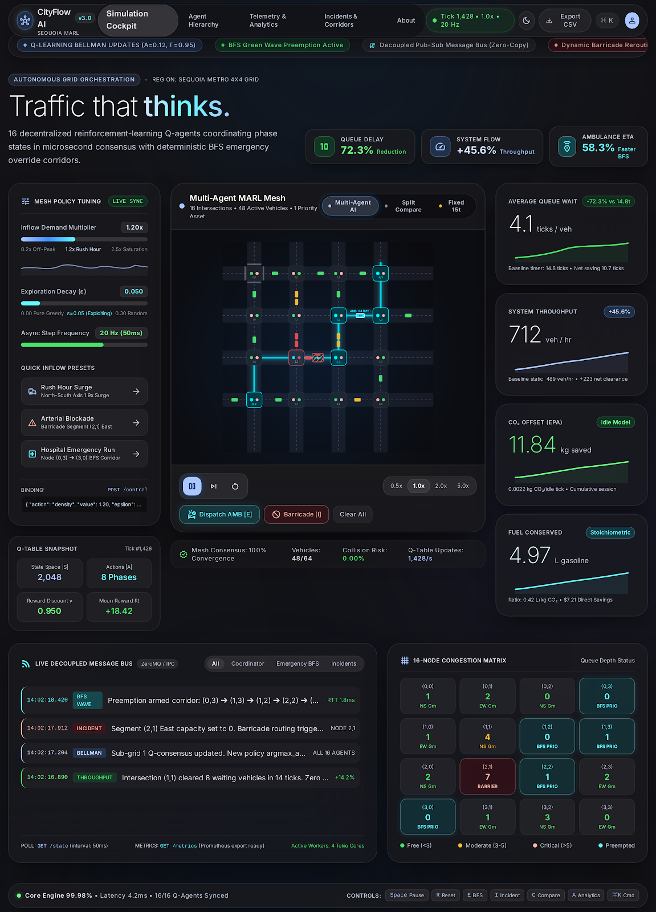

# CityFlow AI: Multi-Agent Autonomous Urban Mobility Platform

An advanced Multi-Agent Reinforcement Learning (MARL) traffic optimization and autonomous grid orchestration platform featuring 16 decentralized Q-learning intersection agents, emergency BFS wave corridor preemption, and dual-mode cybernetic dashboards.



---

## 🌟 Key Features

- **Sequoia MARL Architecture**: 16 decentralized Q-learning intersection agents optimizing 4×4 arterial grid traffic flows with dynamic reward shaping.
- **Dynamic BFS Wave Preemption**: High-priority ambulance transit routing with zero-latency signal preemption green waves.
- **Incident & Barricade Diversions**: Real-time arterial road incident simulation with automated dynamic detour routing and starvation prevention.
- **Glassmorphic VisionOS Studio Cockpit**: 60 FPS live simulation dashboard featuring light/dark cybernetic metropolis backgrounds, live agent telemetry, interactive command palette (`Ctrl+K`), and split-screen compare mode.
- **Diagnostic Canvas View**: Low-latency canvas inspector with congestion heatmaps and per-intersection queue analysis.

---

## 🚀 Quick Start

### 1. Install Dependencies
```bash
pip install -r requirements.txt
```

### 2. Train Multi-Agent Q-Tables (Optional - pretrained weights included)
```bash
python train.py
```
*Trains all 16 intersection agents (~1 min) and outputs performance metrics vs. fixed-timer baseline.*

### 3. Launch Dashboard
```bash
uvicorn main:app --reload
```
- **Modern Cybernetic Cockpit**: [http://localhost:8000/](http://localhost:8000/) (or `/modern`)
- **Classic Diagnostic Canvas**: [http://localhost:8000/classic](http://localhost:8000/classic)
- **OpenAPI Documentation**: [http://localhost:8000/docs](http://localhost:8000/docs)

---

## 📁 Repository Structure

```
CityFlow-AI/
├── docs/                               # Architecture, mathematical formulas, and specs
│   ├── AI_REFERENCE.md                 # In-depth MARL mathematical specification
│   ├── DESIGN.md                       # VisionOS design tokens & aesthetics
│   ├── GOOGLE_FLOW_REFERENCE.md        # Reference specifications
│   └── preview.png                     # Dashboard preview screenshot
│
├── static/                             # Web Frontend & Simulation Cockpits
│   ├── modern/                         # Modern VisionOS Cybernetic Dashboard
│   │   ├── index.html                  # Glassmorphic dashboard UI
│   │   ├── app.js                      # 60 FPS client simulation & telemetry engine
│   │   ├── bg-dark.png                 # 2K Cybernetic Metropolis (Dark mode)
│   │   └── bg-light.png                # 2K Cybernetic Metropolis (Light mode)
│   └── classic/                        # Classic Diagnostic Canvas Cockpit
│       ├── index.html                  # Grid canvas dashboard
│       ├── style.css                   # Classic dark theme styles
│       └── app.js                      # Classic canvas rendering engine
│
├── agents.py                           # 5 MARL agent types + Zero-copy message bus
├── sim.py                              # Traffic physics, 4x4 grid, routing engine
├── train.py                            # Q-learning training & Bellman convergence
├── main.py                             # FastAPI server & real-time simulation tick loop
├── qtable.npy                          # Pretrained Bellman Q-matrix (16 nodes)
├── requirements.txt                    # Python dependencies
├── README.md                           # Project documentation & guide
└── .gitignore                          # Clean gitignore
```

---

## ⌨️ Dashboard Controls & Shortcuts

| Key | Action | Description |
|---|---|---|
| <kbd>Space</kbd> | **Play / Pause** | Toggle simulation execution |
| <kbd>R</kbd> | **Reset** | Reset simulation grid to initial seed state |
| <kbd>E</kbd> | **Ambulance (BFS)** | Spawn emergency ambulance with green-wave corridor |
| <kbd>I</kbd> | **Incident** | Deploy road block and trigger real-time diversion |
| <kbd>C</kbd> | **Compare View** | Toggle split-screen comparison (MARL vs Fixed-Timer) |
| <kbd>A</kbd> | **Analytics** | Open telemetry chart modal |
| <kbd>T</kbd> | **Theme** | Toggle Dark / Light Cybernetic mode |
| <kbd>Ctrl + K</kbd> | **Command Palette** | Quick action modal for all system commands |

---

## 📚 Technical Documentation

For an in-depth mathematical, algorithmic, and programmatic guide designed for AI agents and research developers, see **[docs/AI_REFERENCE.md](docs/AI_REFERENCE.md)**.

---

## 👤 Credits & Author

**Handcrafted by RAJHAVEL V S**

- **LinkedIn**: [https://www.linkedin.com/in/rajhavelvs/](https://www.linkedin.com/in/rajhavelvs/)
- **Portfolio**: [vsrajhavel.github.io](https://vsrajhavel.github.io)
- **GitHub**: [https://github.com/VSRAJHAVEL](https://github.com/VSRAJHAVEL)
